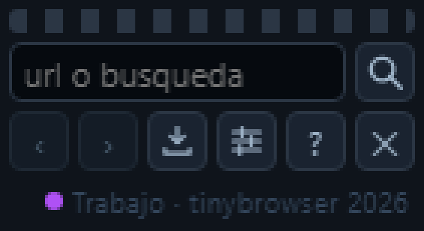
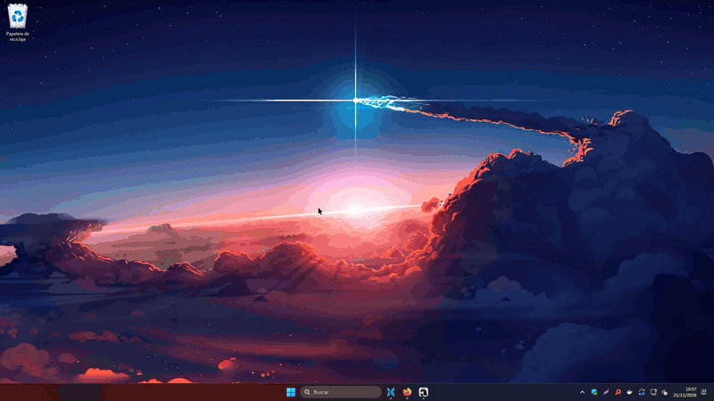

# tinybrowser



**A 160×90 always-on-top browser window for Windows.** Not a tab, not a side panel: a real, frameless
window that sits in a corner of your desktop over whatever else you are doing. Type an address (or a
search) and it navigates right there, with the same engine Edge uses.

**688,640 bytes.** One `.exe`. No installer, no Python, no .NET, no VC++ redistributable: copy it to
any Windows PC and it runs.

[Español](README.es.md) · [Changelog](CHANGELOG.md) · [What's left](SUGGESTIONS.md)



*The full sequence, 46 seconds: [docs/demo.mp4](docs/demo.mp4).*

## Why

Because a whole browser is too much for "keep an eye on this one page". A 160×90 window is small
enough to live in a corner and large enough to read once the page is scaled to fit, and it needs no
window manager gymnastics: it is always on top, it can be pinned per window, and `Ctrl+Alt+C` hides
every copy when you need the desktop back.

The other half of the idea is weight. Embedding an engine would mean tens of megabytes; WebView2 is
already part of Windows, so the program itself is a single 688 KB executable written in C++.

## Run it

- Double click `tinybrowser.exe`. The window opens at the bottom-right corner, always on top, at the
  size of its start bar: **141×77**, the size that puts the magnifier right above the close button.
- It also takes an address: `tinybrowser.exe es.wikipedia.org` (handy for shortcuts, and for
  `--container "Work"`, see below).
- Type and press Enter. No dots means a Google search. The cursor is already in the field.
- The `.exe` is **not code-signed**, so the first run shows SmartScreen's "Windows protected your
  PC": *More info → Run anyway*. The source is here and `build.bat` builds the same binary.
- Every page is scaled so its whole width fits: at 90 px of height, without that you would see one
  corner of the page. `Ctrl` + wheel zooms by hand. The bar and the start page never scale.

## Keys

| Key | What it does |
| --- | --- |
| `Ctrl+Alt+S` | The one-line strip over the page, or back to the start bar |
| `Ctrl+Alt+Z` | Back |
| `Ctrl+Alt+D` | Duplicate this window (same size, 4 px of air, never on top of another) |
| `Ctrl+Alt+A` | Colour eyedropper: pick colours that become see-through |
| `Ctrl+Alt+C` | Hide every window, or bring them all back |
| `Ctrl+Alt+W` | Hide this one window; the next press brings that same one back |
| `Ctrl+Alt+G` | Save this window to a `.to` file, or load one |
| `Ctrl+Alt+T` | New window, even with tiny closed (a small listener owns this one) |
| `Ctrl+Alt+X` | Close |

**Ctrl+click a link** opens it in another tiny window beside this one: same size, 4 px of air, same
container and corners, and no colours keyed — a clean page. If the desktop has no free spot, nothing
opens, just like duplicating. Plain clicks, `target="_blank"` included, still change the current
window.

Resize by dragging any edge or corner; the minimum is **60×60**. When a page loads the window goes
to the page size, **160×90**, and comes back to the bar size when you show the bar — unless you
resized it by hand. Move it with the dotted strip at the top or `Alt` + drag anywhere, page included.

## Containers

A container is a separate set of cookies, sessions, storage, cache, permissions and history for the
same window — the thing you need to keep two Google accounts open at once, or work and personal apart.
It is a WebView2 profile inside the same data folder, so it costs no extra browser process.

- The **Contenedor** row at the top of the options panel lists the containers that already exist;
  **Nuevo…** asks for a name in the same line and creates it. Choosing another one reloads the page in
  that profile: window, size and zoom stay.
- The brand line at the bottom-right of the bar shows the container with a coloured dot (nothing in
  the Default profile).
- `.to` snapshots remember their container, `Ctrl+Alt+D` duplicates inside the same one, and a
  shortcut can open straight into it: `tinybrowser.exe --container "Work"`.
- The names live in the `[containers]` section of `tinybrowser.ini`; each container's data is its own
  folder inside `%LOCALAPPDATA%\tinybrowser`.

## Colour transparency

`Ctrl+Alt+A` arms an eyedropper: the pointer becomes a pipette and a click anywhere on the screen
picks that colour. Everything painted in that colour disappears from **that** window (and no other),
so the desktop shows through. Pick several colours and they all go at once, up to 12; picking one
again brings it back. `Escape` or the right button leaves the eyedropper with the colours as they are.

The filter is one SVG pass over the page, computed per pixel, so it reaches animated GIFs, video and
canvas too. The **Rango del color** slider (0–40, default 5) is the tolerance: screens return a colour
that can differ by a level or two from what the page painted.

## Rounded corners

The **Esquinas** slider at the top of the options panel rounds the four corners of **that** window:
0 leaves the rectangle it has always been, and 100 takes the largest radius four equal corners allow —
half the shorter side — so a 160×90 window becomes a capsule and a 60×60 one a circle. The window
changes shape while the slider moves, with no reload. It is a property of the window, like the pin:
each one keeps its own, `.to` snapshots remember it and `Ctrl+Alt+D` copies it (`--radius N` from a
shortcut). The start bar caps its own radius at 10 px so its address field and buttons stay inside
the shape.

## Snapshots: `.to` files

`Ctrl+Alt+G` on a page opens a save dialog and writes a **`.to`** file: the address, the window's
position and size, the zoom, and the colours that were made transparent. Double-clicking it in
Explorer opens tiny with that window exactly as it was. It is a text file (`[tiny]` and one line per
value), so you can edit the address with Notepad.

## Options

The button with three lines and knobs opens the panel (click outside it or `Escape` closes it). The
switches are app-wide and live in `tinybrowser.ini`, next to the exe:

- **No solapar ventanas**: a window never ends up on top of another; dragging into a neighbour stops
  4 px short, diagonally it slides past.
- **Al tirar, empujar otras**: instead of stopping, the window being dragged pushes its neighbours
  aside, in right angles, by the side each one has room on. Needs the switch above, so it stays
  disabled in place while that one is off.
- **Solo en notificaciones**: no taskbar button; one tray icon for the whole app (left click shows or
  hides every window, right click has new window and exit).
- **La tira queda abierta**: the strip stays after using one of its buttons.
- **Rango del color**: the tolerance of the transparency, 0–40.

## Install it

The arrow-to-tray button (where reload used to be) opens the install panel. Everything happens in
your user account: no administrator rights.

- **Install** copies the exe to `%LOCALAPPDATA%\Unresolute\tinybrowser\tiny.exe`, adds that folder to
  the user `PATH`, and reassociates `.to` files with the installed copy. It also leaves a **Tiny
  Browser** entry in Settings → Installed apps, with its version and an uninstaller.
- **Update** is the same button when the installed copy is older; the versions are compared by reading
  each exe's version resource, not by file dates. **Remove** takes the PATH, the association, the icon
  and the folder away; the WebView2 data folder stays, because that is where your logins are.
- `tiny.exe --uninstall` does the same as the Settings uninstaller.

## Build

```
build.bat
```

Needs **Visual Studio Build Tools 2022 with the C++ workload** (`cl.exe`, `rc.exe`, the Windows SDK).
The build is self-contained: if the WebView2 SDK is missing, `tools/fetch-sdk.ps1` downloads it from
NuGet into `sdk/` (out of the repo) and then compiles the code and the icon resource. Out comes a
single statically linked `.exe` (`/MT`, `/O2`, `/OPT:REF`, `/OPT:ICF`).

Everything else, down to the measured details of the fit and the icon pipeline, is in the
[Spanish README](README.es.md).

## Requirements

- Windows 10 or 11, 64 bits.
- The **WebView2** runtime (the one Edge installs). It ships with Windows 11 and with most Windows 10
  machines. If it is missing, the app offers to install it: it looks for
  `MicrosoftEdgeWebview2Setup.exe` next to the exe and runs it silently, or opens Microsoft's page.

## Licence

MIT — see [`LICENSE`](LICENSE).
