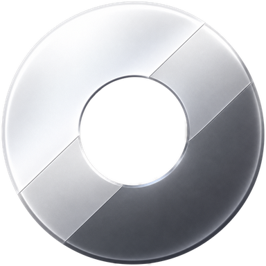

# tinybrowser

Un navegador de escritorio de **160x90 píxeles**: una ventana sin marco, siempre encima, para
tener un sitio a la vista mientras trabajás en otra cosa. No es un visor de una URL fija — le
escribís una dirección (o buscás) y navega ahí mismo, con el motor de Edge embebido.

**221.184 bytes.** Un solo `.exe`, sin Python, sin .NET y sin la redistribuible de Visual C++:
se copia a cualquier PC con Windows y anda.

## Usar

- Doble clic en `tinybrowser.exe`. Abre pegada a la esquina inferior derecha, siempre encima, con
  el tamaño de la barra: **141x77**, el que hace que la lupa caiga justo encima del botón de cerrar
  y que la marca tenga el mismo aire arriba que abajo (medido: 0,0 px y 4 px contra 4 px).
- También acepta una dirección: `tinybrowser.exe es.wikipedia.org` (sirve para accesos directos).
- Escribís la dirección y Enter. Sin puntos = búsqueda en Google. Al abrir, el cursor ya está en
  el campo: escribís directo, sin cliquear.
- Cada página se escala sola para que entre a lo ancho: con 90 px de alto, sin eso verías "una
  esquina" de la página. `Ctrl` + rueda para acercar a mano. La barra y la pantalla inicial no se
  escalan: sus controles mantienen el mismo tamaño, tenga la ventana el tamaño que tenga.
- `Ctrl+Alt+S` vuelve a la barra desde cualquier página, `Ctrl+Alt+Z` va atrás, `Ctrl+Alt+D` duplica
  en otra ventana y `Ctrl+Alt+X` cierra.
- `Ctrl+Alt+A` arma el gotero: el puntero se vuelve una pipeta y el clic en cualquier parte de la
  pantalla toma ese color. La punta de la pipeta es exactamente el píxel que se lee, y el bulbo
  muestra en vivo el color que va a desaparecer. El gotero sigue armado después de cada clic, así que
  podés tomar **varios colores seguidos** y todos se vuelven transparentes a la vez en **esa**
  ventana (y en ninguna otra): se ve lo que haya detrás. Volver a tomar un color que ya está
  transparente lo devuelve a la vista sin tocar los demás, y entran hasta 12. Mientras dura, las
  barras de scroll (vertical y horizontal) se ocultan: una barra dibujada quedaría encima del
  agujero. `Escape` o el botón derecho salen del gotero y dejan todo lo elegido como está;
  `Ctrl+Alt+A` en ese momento también sale, y otra vez `Ctrl+Alt+A` devuelve la ventana a la
  normalidad, con sus barras.
- `Ctrl+Alt+C` las oculta a todas: cada copia abierta sale de la pantalla y de la barra de tareas,
  y el mismo `Ctrl+Alt+C` las vuelve a mostrar todas juntas. Es la única forma de ocultarlas y de
  traerlas de vuelta; al volver, la que retoma el teclado es la que estaba en uso.
- El `?` de la barra abre la lista de comandos, encima de todo; se cierra con un clic o `Escape`.
  La pantalla inicial muestra `tinybrowser 2026` pegada abajo a la derecha.
- Se agranda y encoge arrastrando cualquier borde o esquina: a menos de 4 píxeles del borde el
  puntero cambia a las flechas de redimensionar (salvo justo encima de un scrollbar, donde el motor
  no le pasa el mouse a la página: ahí el borde redimensiona igual, pero el puntero no cambia). El mínimo es **60x60**. Al navegar la ventana pasa
  al tamaño de página, **160x90**, que es lo que una página necesita para leerse, y vuelve al de la
  barra cuando la mostrás. Si la redimensionaste a mano, esos cambios no la tocan. Al cambiar el
  ancho, la página se ajusta sola. El tope para agrandar es el borde de la pantalla, no la barra de
  tareas: si la ventana está sobre ella, también se redimensiona ahí.
- Para moverla: la franja punteada arriba de la barra, o `Alt` + arrastrar en cualquier parte
  (incluso encima de una página cargada). Va a cualquier lado del escritorio, incluso encima de la
  barra de tareas; el único tope es que no se pierda fuera de la pantalla.
- Atrás / adelante / recargar están en la barra; el `x` de la derecha cierra. Recargar y atrás
  actúan sobre la página que tenías cargada, no sobre la barra. Hasta que no hayas cargado una
  página, esos botones aparecen apagados: no hay nada sobre qué actuar.
- Los enlaces que abren pestaña nueva se cargan en la misma ventana.
- **Se pueden abrir varias ventanas a la vez**, cada una independiente, para repartirlas por la
  pantalla. Comparten el perfil, así que los logins y las cookies valen para todas.
- El botón de las tres líneas con perillas de la barra abre las **opciones** (ver más abajo); el
  botón de duplicar ya no está, porque en la pantalla inicial no servía: duplicar se hace con el
  atajo.
- `Ctrl+Alt+D` abre la página actual en **otra ventana**
  del mismo tamaño, con **4 px de aire** respecto de las que ya hay y nunca encima de otra, ni por un
  píxel: si el conjunto tiene un hueco (una L, un cuadrado al que le falta una celda) la nueva cae
  justo ahí; si no, en el lado libre más cercano a la ventana desde la que duplicaste, prefiriendo lo
  que deje el grupo rectangular antes que una fila larga. Si no queda ningún lugar libre, no abre
  nada: no hay copias superpuestas.
- Los atajos actúan sobre la ventana que estás usando cuando hay más de una abierta; con una sola
  siguen funcionando desde cualquier programa, como antes.

### Guardar un estado: los archivos `.to`

- `Ctrl+Alt+G` con una página abierta abre el diálogo de guardar y escribe un archivo **`.to`**
  (*tiny object*): ahí queda congelado cómo se está viendo esa ventana — la dirección, la posición y
  el tamaño, el zoom, y los colores que hayas transparentado con su rango.
- Doble clic sobre el `.to` en el Explorador abre tiny con esa ventana tal como estaba, en una
  ventana nueva. La asociación del `.to` con el exe se hace sola la primera vez que guardás uno y se
  reafirma en cada arranque, así que mover el exe no la rompe. Si otro programa ya era dueño de `.to`,
  no se le toca: en ese caso el archivo se abre arrastrándolo sobre `tinybrowser.exe`.
- `Ctrl+Alt+G` en la pantalla de inicio es la otra mitad: abre el selector de Windows para elegir
  cuál de los `.to` cargar. Durante esa ejecución el selector vuelve a abrirse en la última carpeta
  usada; nada de esto se guarda en el archivo de opciones.
- El archivo es texto (`[tiny]` y una línea por dato): se puede abrir con el Notepad y cambiar la
  dirección a mano. Los colores transparentados van en una sola línea (`KeyColours`), separados por
  comas.
- Dos cosas que conviene saber: el zoom guardado manda mientras esa página esté abierta (aunque
  redimensiones la ventana; el ajuste automático vuelve al abrir otra dirección en la barra), y el
  rango del color es una opción compartida, así que cargar un `.to` con otro rango lo cambia en
  todas las ventanas, igual que el control.

### Cómo funciona la transparencia por color

La ventana no dibuja nada por su cuenta: el motor pinta en un árbol de DirectComposition (hosting por
composición) y la ventana no tiene superficie GDI, así que lo que se ve es exactamente esa
composición, con su canal alfa. Por eso el color elegido puede volverse un agujero de verdad.

El filtro va sobre la página entera, no sobre un elemento: cada color elegido se vuelve transparente
allí donde aparezca, sea el fondo de un div, los píxeles de un GIF o el texto. Es un filtro SVG que
calcula píxel por píxel la distancia a cada color y la convierte en transparencia, y no necesita leer
píxeles, así que alcanza igual a GIF animados, videos, canvas e imágenes de otro origen. Cada color
aporta su propia máscara y las máscaras se multiplican entre sí: un píxel desaparece si coincide con
cualquiera de ellas, y por eso varios colores se pueden tener transparentes al mismo tiempo sin que
uno tape al otro.

Y como la base de la página también deja de pintar, el agujero no se queda en el fondo de la página:
lo que se ve a través es el escritorio. Dicho al revés: si había algo debajo de ese color, también
desaparece.

La comparación tiene una tolerancia, porque la pantalla puede devolver un color que difiere en una o
dos unidades del valor que tenía en la página. Ese margen es el control **Rango del color** de las
opciones: 0 quita sólo el color exacto y cada punto agrega un nivel por canal, hasta 40. Se guarda en
`tinybrowser.ini` como `KeyRange` y vale para todas las instancias (por defecto 5).

## Opciones

El botón de las tres líneas con perillas, en la barra, abre el panel de opciones (se cierra con un
clic fuera de los controles o con `Escape`). Son dos interruptores y se guardan en `tinybrowser.ini`,
al lado del exe, así que valen para todas las ventanas y siguen ahí la próxima vez:

- **No solapar ventanas** (activado de fábrica): ninguna ventana puede quedar encima de otra. Al
  arrastrarla contra una vecina se detiene a 4 px —cada ventana reserva 2 px de su lado— y en
  diagonal se desliza por el costado en vez de trabarse. Al agrandarla con un borde pasa lo mismo:
  el borde se detiene. Las ventanas que ya estaban superpuestas antes de activar la opción se quedan
  como están; si las separás, ya no se pueden volver a superponer.
- **Al arrastrar, empujar otras** (apagado de fábrica): en vez de detenerse, la ventana arrastrada
  corre a la que choca, siempre en ángulos rectos y por el lado que le toca: la empujada sale hacia
  donde ya está respecto de la otra y por donde menos tiene que moverse, nunca por donde va el mouse.
  Si choca con varias, se corren en cascada, cada una por su propio lado. Cuando alguna no tiene
  lugar para correrse, la que arrastraste se detiene como si la opción estuviera apagada. Necesita la opción de arriba: sin "no solapar" no tiene sentido, por eso queda
  deshabilitada en su lugar mientras aquella está apagada. El redimensionado empuja igual.
- Cookies y sesiones viven en `%LOCALAPPDATA%\tinybrowser`, así que los logins persisten.

## Requisitos

- Windows 10 u 11, 64 bits.
- El motor **WebView2** (el mismo de Edge). No va dentro del `.exe`: ya viene en Windows 11 y
  en la mayoría de los Windows 10, porque viene con Edge. Si faltara, al arrancar sale un
  cartel que ofrece instalarlo: busca `MicrosoftEdgeWebview2Setup.exe` al lado del `.exe` y lo
  corre en silencio (~150 KB, copialo si vas a distribuir a PCs viejas), o si no abre la página
  de descarga de Microsoft.

## Compilar

    build.bat

Necesita **Visual Studio Build Tools 2022 con la carga de C++** (compilador `cl.exe`, `rc.exe` y
el SDK de Windows). El build es autocontenido: si falta el SDK de WebView2,
`tools/fetch-sdk.ps1` lo baja de NuGet solo (~10 MB que quedan en `sdk/`, fuera del repo) y
después compila el código y el icono como recurso. Sale un único `.exe` enlazado estáticamente
(`/MT`, `/O2`, `/OPT:REF` e `/OPT:ICF`).

## Arranque

La ventana se pinta al instante (~90 ms, con el fondo oscuro) y el motor queda listo en ~0,6 s
en caliente. La primerísima ejecución tarda más: es el arranque en frío de WebView2 (creación
del perfil), no del programa.

## Cómo está hecho

| Qué | Dónde |
| --- | --- |
| Todo el programa | `tinybrowser.cpp` (Win32 + WebView2) |
| Icono | `tinybrowser.ico` + `tinybrowser.rc`; se regenera con `tools/make_icon.py` |
| Compilación | `build.bat` |
| SDK de WebView2 | lo baja `tools/fetch-sdk.ps1` a `sdk/` (NuGet `Microsoft.Web.WebView2` 1.0.4258.31) |
| Tamaño de la ventana | `kWidth` / `kHeight` |
| Buscador | `kSearchPrefix` |
| Atajos | `kHotkeyBar` / `kHotkeyQuit` |
| Carpeta de datos | `UserDataFolder()` |
| Ajuste de ancho por página | `FitPageWidth()` / `ApplyFitZoom()` |
| Mover la ventana | `MoveBy()` (lo disparan la barra y `Alt`+arrastrar) |
| Normalizar direcciones | `Normalize()` |

Tres decisiones que explican el resto:

- **WebView2 embebido, no empaquetado.** Meter un motor entero daría un `.exe` de decenas de MB;
  como el motor ya vive en Windows, el programa son cientos de KB. El precio es el requisito de
  arriba.
- **Un solo hilo tocando el motor.** El intento anterior en Python se congelaba (AppHangB1)
  porque una capa intermedia llamaba a COM desde otro hilo. Acá todas las llamadas a WebView2
  salen del mismo hilo que el bucle de mensajes.
- **El icono se dibuja por código, no en un editor.** `tools/make_icon.py` genera el `.ico`
  (entradas BMP de 4 bits, paleta VGA de 16 colores, 16/32/48 px, 2,7 KB en total) y además un
  pliego con todas las variantes en `tools/preview.png`, para poder comparar y volver atrás sin
  depender de la memoria.

## Nitidez a 160 píxeles

La ventana no dibuja más píxeles de los que tiene, así que lo único que se puede pelear es *cómo*
se dibujan. Lo que quedó aplicado:

- **Antialias gris** (`--disable-lcd-text`, inyectado por `WEBVIEW2_ADDITIONAL_BROWSER_ARGUMENTS`):
  fuera los flecos rojos y azules del ClearType. Medido en la misma página, en los bordes de letra,
  el desvío medio de color bajó de **30,15 a 9,98** (y lo que queda son los colores propios del sitio).
- **Letra en píxeles enteros**: en vez de un zoom continuo, se mide la fuente del cuerpo del sitio y
  se elige el mayor número entero de píxeles físicos que entra en el ancho, de modo que el zoom sea
  esa división exacta. Así el rasterizador tiene una rejilla donde encajar los trazos en lugar de
  trabajar con medidas fraccionarias.

Lo que se probó y **no** funciona, con los números:

- **Renderizar al doble y bajar (supersampling)**: en una ventana de tamaño fijo no hay quién
  reduzca la superficie, así que subir `RasterizationScale` al doble **recorta** en vez de promediar
  (la página se ve más grande y cortada a la derecha y abajo). Simulado el proceso completo —render
  al doble y promedio 2x2, mismo contenido, mismo maquetado y mismo tamaño final— el resultado pierde
  contraste: la luminancia media de los 200 píxeles más oscuros del texto pasa de **9,1** (casi negro)
  a **124** (gris medio), y los 160 píxeles negros del render directo desaparecen. Es esperable: al
  promediar, un trazo de un píxel se reparte entre dos y deja de llegar al negro pleno. Más suave,
  menos nítido.
- Queda sin explorar la emulación móvil (que cambia qué maquetado sirve el sitio) y el
  `--font-render-hinting`, probablemente un no-op en Windows, que rasteriza con DirectWrite.

El cálculo del ajuste recorre los elementos de la página, y resolver estilos es lo caro: descarta por
rectángulo lo que no puede superar al más ancho visto, antes de mirar sus ancestros. Medido en una
página de 24.667 elementos: **470 ms por pasada, a 65 ms**, con el mismo resultado.

## Estado

Anda: navegar, buscar, atrás/adelante/recargar, scroll, zoom, arrastre, redimensionado (mínimo
60x60), varias ventanas a la vez con duplicar la actual en otra, guardar la ventana en un `.to` y volver a abrirla como estaba, atajos, sesiones persistentes,
icono propio y cierre limpio (sin procesos huérfanos).

Todavía no: historial navegable, autocompletado en la barra, pestañas ni diálogos para elegir el
perfil. El zoom se reajusta por página, así que una página muy ancha queda con letra chica.

## Licencia

MIT — ver [`LICENSE`](LICENSE).
